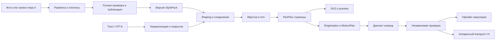
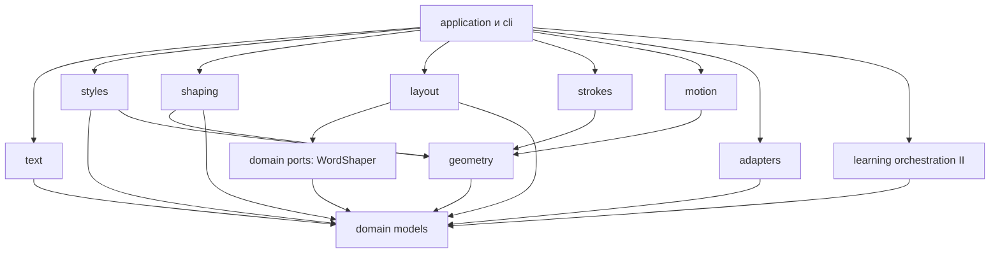
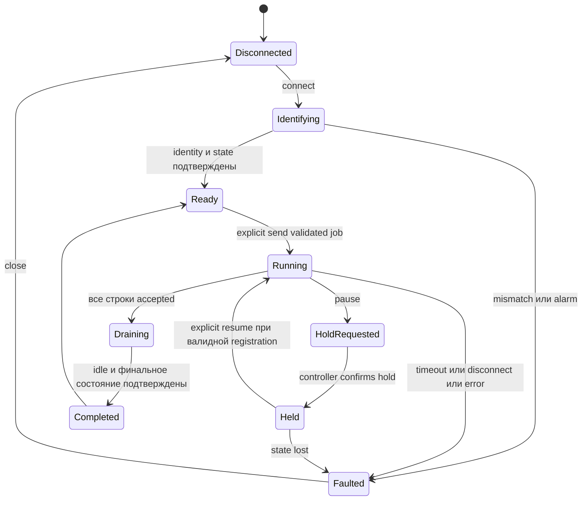
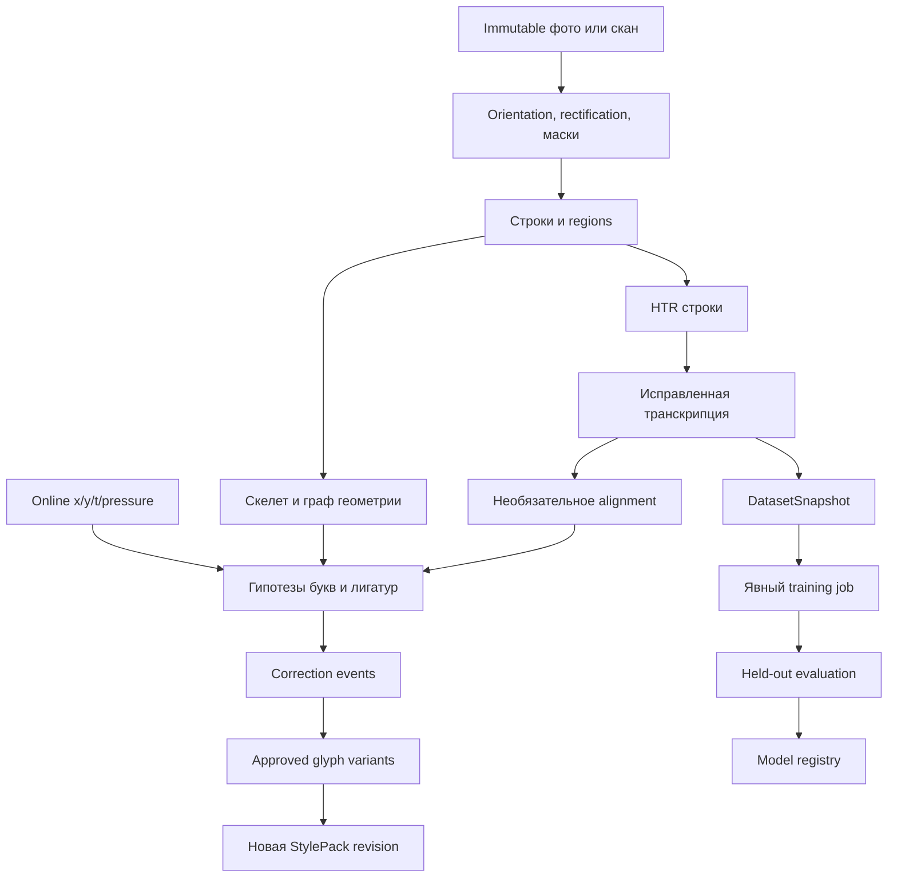

# Архитектура и алгоритмы

v1.0 · [Решения](DECISIONS.md) · [Модели](DATA_MODELS.md) · [Контракты](MODULE_CONTRACTS.md).

## 1. Границы системы

Один локальный Python package `handwriting_plotter`, CLI `hplot`, файловые артефакты. Внутри девять областей, а не 21 сервис. Geometry/Stroke IR — нижний общий слой, orchestration — верхний. OCR и CNC transport не импортируются при обычной генерации.

Зависимости импортов (стрелка означает «использует»):

Application передаёт конкретный `shaping` в порт WordShaper; layout не импортирует application. Адаптеры реализуют domain ports и не вызывают CLI. Будущий UI вызывает application; firmware не определяет модели glyphs.

## 2. Разделение ответственности

| Область | Что объединяет из требований | Чего здесь нет |
|---|---|---|
| domain / geometry | DTO, frames, кривые, bounds, transforms, flatten | FS, ML, порты, глобальный RNG |
| text | Text Processing, Unicode, графемы, break opportunities | Подмены букв и OCR-коррекция смысла |
| styles | Style Management, библиотека samples/fonts, coverage, revisions | Пользовательские executable plugins |
| shaping | Glyph resolution, variants, context, ligatures, joins | Координаты страницы/станка |
| layout / strokes | Пагинация, размещение, ordered PenPlan | Оптимизация маршрута с перестановкой письма |
| motion | Registration, ограничения, линейные движения, time estimates | Генерация motor pulses и неизвестная кинематика |
| adapters | SVG, G-code dialects, импорт, serial/file/simulator | Решения о том, какая буква написана |
| learning (II) | CV, HTR, regions, reconstruction, corrections, training | Самостоятельная публикация непроверенного почерка |
| application / storage | Job orchestration, атомарный output, журнал, будущий UI API | HTTP-сервер и графические компоненты MVP |

## 3. Производство стартового почерка

Это работа над данными, выполняемая после разрешения реализации. Нельзя считать алфавит на скриншоте готовым StylePack.

1. Выбрать одного автора/дизайнера рукописного стиля и зафиксировать права на авторские центральные линии. Начать с 15–20 трудных букв и частых пар: `і ї й ґ є т ш щ м л о в р`, латинских `i t x Q X`, апострофов. Проверить гипотезу связного письма до рисования полного пакета.
2. Отрисовывать центральные пути готовым редактором SVG с явными направлением/порядком; для каждого glyph сохранять отдельные paths и sidecar metadata. Альтернатива — писать стилусом готовым Tracer, импортировать raw JSON. Это подготовка данных; свой интерфейс захвата сейчас не нужен.
3. Изолированная буква не определяет правильный вход/выход. Дополнительно получить записи пары/слова в естественном письме, затем вручную отделить допустимые body/marks и anchors. Не растягивать произвольную печатную букву ради соединения.
4. Привести все данные к baseline=0, x-height=1000 gu. Записать advance отдельно от bbox. Для буквы `ї` сохранить обе точки, для `й/ё` обязательные надстрочные элементы. Простое копирование Latin i → Cyrillic і допускается только как явное авторское решение для двух keys, не Unicode substitution.
5. Снять минимум три качественных варианта каждой строчной буквы и один остальных обязательных знаков; затем все coverage/pair fixtures. Лигатуры начального выпуска необязательны для полноты алфавита, но минимум две собственные тестовые лигатуры нужны для проверки движка; включать в production только прошедшие review.
6. Для каждого класса anchors определить allow rules, для исключений — deny. Если форма не подходит, исправить данные или оставить pen lift. Набор может содержать честные разрывы, но не проходить под именем связного почерка, если почти все пары разъединены.
7. Публиковать только immutable revision с отчётом покрытия и визуальной приёмкой. Отсутствие готового файла начального почерка — реальный deliverable gap, не задача, которую Codex должен «догадаться» заполнить TTF.

## 4. Text Processing

Порядок: decode UTF-8 → CRLF/CR normalization → сохранение source map → сегментация исходных clusters → NFC каждого кластера → токены и список допустимых breaks → полная проверка покрытия. Нельзя изменять регистр, алфавит или похожие символы. C0 controls кроме tab/LF/form-feed и bidi format controls отклоняются с позицией; RTL shaping вне v1.

Tab разворачивается до следующей tab stop в 4 nominal spaces по текущему горизонтальному advance. Whitespace между словами сохраняется; trailing spaces не рисуются и не расширяют ink bounds. NBSP и narrow NBSP удерживают соседние части на одной строке. LF — hard line break, form-feed — page break. Пустая строка добавляет один line pitch; paragraph gap применяется после пустой строки один раз, а не после каждого LF.

Для UA/RU/EN разрешены breaks на обычных пробелах и после видимого дефиса. Открывающая скобка/кавычка прикреплена к следующему слову, закрывающая и `.,:;!?…` к предыдущему. Апострофы `' ’ ʼ` между буквами входят в lexical word, но разрывают pen connectivity. Дефис внутри слова создаёт допустимую точку переноса, сохраняется как исходный знак. Цифры/единицы через NBSP не делятся. Эти правила — tailored LTR policy, не полная UAX14.

## 5. Shaping и вариативность

Для слова/фрагмента вычислить контекст каждой графемы: isolated/initial/medial/final внутри соединяемого script run. Longest-match ligature search по trie (максимум 8 графем) не пересекает whitespace, explicit break, script boundary или punctuation. Переходы вида латинская a → кириллическая а не объединяются.

Из eligible variants выбрать детерминированный вариант по DATA_MODELS; сохранить occurrence IDs и журнал выбора. Контекстные варианты имеют приоритет перед универсальным. Если нет eligible context form, взять isolated fallback и запретить join на проблемной границе. Совпадения между runs и видимое слово не меняются при повторном измерении.

Применить uniform scale, baseline-pivot shear и baseline offset к **всей букве и anchors**. Перед вычислением connectors ни один endpoint не остаётся в старой системе координат. Измерить окончательные тела букв. Межбуквенное положение начинается с advance + фиксированного pair spacing из style; не использовать случайный optical kerning сканирующий произвольный raster.

Если variation создаёт столкновение, повторить построение текущего слова с amplitude 0.5×, затем 0; тот же выбор вариантов. Если столкновение сохраняется, один deterministic retry с увеличением соответствующего pair gap на 0.1h, максимум до 0.25h сверх nominal. Если и это не помогает — INVALID_STYLE_PAIR с исходной парой/variant IDs. Не гонять бесконечный поиск seed. Изменённые параметры записать в diagnostics; применение fallback меняет hash результата через effective parameters.

## 6. Соединения: конкретный алгоритм

Соединять только соседние `single_body_deferred_marks` с разрешённой class pair и endpoint anchors. Проверить context flags, shared script, отсутствие разделителя, расстояние и угол после всех glyph transformations. Нулевые tangents — invalid style.

Начальные верхние пределы для ещё не откалиброванного стиля: расстояние anchors ≤0.8h, разница Y ≤0.5h, направление каждого tangent относительно вектора разрыва ≤60°. В manifest после визуальной проверки лимиты можно только ужесточить в `ua-school-v1`; расширение — новая review revision.

Построение cubic: P0=exit, P3=entry, d=|P3−P0|; C1=P0+u_exit*d/3, C2=P3−u_entry*d/3. Когда anchors совпадают, не создавать нулевой connector: chain можно объединить только при согласованных tangent directions. В противном случае lift. Нельзя автоматически перебирать произвольные сплайны, проходящие через тела букв.

Проверки connector:

- C0 непрерывность через единые endpoints; tangent continuity по направлению (G1, не обещание одинаковой скорости C1).
- Путь не содержит loops/self-crossings; после flattening с error bound нет обратного X участка для данного join class. Exceptions требуют заранее authored ligature.
- Connector не приближается к чужому body/mark ближе суммы half-widths + clearance 0.05 mm вне endpoint neighborhood радиуса 0.1h. Для near-threshold случая консервативно отклонить. Полилинейные distance checks учитывают удвоенный flatten error; разрешённые intentional crossings внутри авторской буквы не запрещаются.
- Ink bounds, включая connector и width/2, входят в shape envelope. Один bbox test недостаточен для collision, это только broad phase.

Если проверка не пройдена — убрать connector, оставить два strokes и pen lift. После этого проверить читаемое расстояние между буквами. Не нужно соединять каждую пару любой ценой. Изменение характера письма отражается в join coverage report.

**Порядок**: body A → connector → body B → … → lift; затем deferred marks слева направо по glyph occurrence, внутри glyph — authored order. Конец connected run при punctuation, incompatible glyph или конце слова. Несоединяемые glyphs исполняются в authored order в месте чтения. Marks не переносятся через границу слова. Это правило должно быть разрешено автором style, иначе glyph имеет join_mode=none.

## 7. Вёрстка и пагинация

Layout зависит только от WordShaper port и immutable style snapshot. Он может запрашивать shape фрагмента длинного слова; shaper не знает страницу. Cache key: grapheme IDs + boundary context + style revision + variation config.

1. Shape очередной токен или NBSP group. Occupied interval по X = `[min(0, ink_min_x), max(advance, ink_max_x)]` с учётом ширины пера. Это предотвращает выход отрицательного bearing в левое поле и хвоста за правое.
2. Последовательно укладывать words по occupied widths и измеренным spaces. Максимальная ширина = printable rectangle. Whitespace-only tail не создаёт строку. Нельзя измерять по количеству символов.
3. Если очередное слово не помещается и строка не пуста — закончить строку и повторить то же слово без нового variant sampling. Если oversized в пустой строке — пройти по grapheme prefixes, reshape с правильными terminal/initial contexts; взять последний префикс до первого overflow. Не предполагать монотонность ширины по количеству code points и не использовать бинарный поиск. Это greedy policy, не обещание глобально максимального префикса.
4. Лигатура на границе распадается с reshaping исходных графем. Служебный дефис не добавляется. NBSP group не делится; если не помещается целиком, NONBREAKABLE_OVERFLOW. Один oversized glyph → GLYPH_TOO_WIDE. Emergency split не ставит closing punctuation на начало строки, если оно должно быть прикреплено.
5. Размер одного emergency token ограничен 4096 графем, shaping operations/job — 1 000 000. При превышении вернуть ресурсную ошибку. Не урезать input и не замалчивать остаток.
6. Для строки найти реальные minY/maxY всех strokes и marks. Зарезервировать ±0.10 mm на line translation и width envelope. Следующая baseline = max(previous baseline+requested pitch, previous ink bottom+0.5 mm−next ink top относительно baseline). Таким образом большие буквы увеличивают эффективный интервал с предупреждением, не накладываются на соседнюю строку.
7. Если полная строка не помещается по высоте — новая страница; oversized line в пустой странице → LINE_TOO_TALL. Baseline первой строки выбирается так, чтобы её верхняя ink envelope совпала с верхним полем + reserve. Никакой скрытой обрезки или масштабирования текста.
8. Применить детерминированную line translation, проверить окончательные bounds. Горизонтальная вариативность строки в MVP отключена. Каждая grapheme должна иметь page/source coverage либо быть layout control; потери/дубли — ошибка.

## 8. Stroke Engine и SVG

Stroke Engine превращает execution groups в PenPlan (DATA_MODELS §5). Он не угадывает следующий nearest stroke. Перед каждым disconnected stroke — поднятый переход. Он сохраняет явные critical marks и не «оптимизирует» их как шум.

Geometry module предоставляет evaluation, split, affine transform, tangent, bounds, flatten, segment distance. Bounds line — endpoints; Q/C — endpoints плюс корни производной каждой координаты внутри [0,1], при численной вырожденности fallback conservative control hull. Width/2 и error reserve добавляются отдельно. Проверка не ограничивается control endpoints.

Чистый SVG: один файл на страницу, `width=210mm`, `height=297mm`, `viewBox=0 0 210 297`, paths M/L/Q/C, fill none, round caps/joins, fixed stroke width. Один path на непрерывный контакт пера; никаких hidden travel lines в производственном SVG, `<text>`, bitmap, filter, CSS font dependencies или implicit close. Metadata связывает path со stroke IDs. `<` и `&` в метаданных экранируются XML writer.

Preview отдельный: нарисованные пути, пунктирные travel moves, номера/стрелки strokes и границы. Его нельзя перепутать с production SVG: suffix `.preview.svg`, manifest role=diagnostic. Даже чистый SVG сторонний sender может переупорядочить; сохранение authored order гарантируется нашим PenPlan/backend, не любым сторонним инструментом.

## 9. Motion и аппаратная граница

Сначала preflight profile/capabilities + registration + start state, затем Page→Work transform, затем flatten, назначение feeds, pen actuation, quantization, повторная проверка, dialect emit и независимый decode. Любой mismatch блокирует отправку.

В случае Cartesian machine с firmware planner host отправляет ограниченную последовательность G1. Firmware определяет ускорение и прохождение углов. Проверяемая скорость — верхний requested bound; motion simulation не знает backlash, missed steps, давление и фактическую работу пружины. Backend для полярной/SCARA кинематики обязан проверять преобразованный путь, промежуточную достижимость, joint limits и singularities. Пока такого backend нет, профиль kinematics unsupported отвергается.

Перо — синхронизируемая операция: закончить предшествующий stroke → поднять/выдержать → travel → опустить/выдержать → draw. Команды actuator должны обладать подтверждённой очередностью относительно motion queue. M3/M5 без доказанного поведения не принимаются за «обычный servo».

Проверяются не только drawn endpoints, но и весь travel, initial move, Z, optional park и forbidden zones. V1 printable travel plane — выпуклый прямоугольник; прямой сегмент в нём допустим при допустимых концах. При наличии obstacles применяется segment intersection с расширением на tool envelope; v1 **отказывает**, не ищет обход. Clipping пути запрещён.

MachineProfile обязан задавать tool envelope, используемый для clearance. Если измеренная ширина пера больше PageSpec.pen_width_mm, аппаратный preflight требует заново провалидировать/сгенерировать документ с этой шириной: успешно измеренные тонкие SVG линии не доказывают, что более толстая ручка поместится в поля. Actuation expansion раскрывается до проверки bounds и времени; SetPen не исполняется дважды как macro и как её вложенные moves.

Хост не меняет firmware acceleration/homing settings автоматически. Profile mismatch, неизвестный origin, alarm и simulation-only artifact запрещают hardware send. Если профиль требует G54/другое рабочее смещение, его setting/readback принадлежит конкретному backend; виртуальное G90 не определяет реальное рабочее начало.

## 10. CNC Communication I-H

Первый real protocol — выбирается по оборудованию, не сейчас. Если GRBL v1.1 подтверждён, начальный sender использует send-one-line/wait-ok для простоты, при необходимости отдельный character-counting buffer mode после тестов. Status/alarm/ok парсятся раздельно. Performance gate может показать необходимость буферизации — менять transport, не stroke order.

Не повторять движение после timeout: предыдущая строка могла быть исполнена. Checkpoint подтверждается только после drain/idle и известного pen state. Software pause/feed hold не равен аппаратному emergency stop. Abort semantics описывает backend; после reset origin/pen могут стать UNKNOWN. Нельзя обещать физический подъём пера при потере питания или обрыве serial.

Смена листа — отдельное завершённое page job, ручная установка и повторная проверка registration. Не вводить G-code M0 без проверки поддержки. В MVP несколько страниц не означают автоматический feeder.

## 11. Персонализация и OCR: независимые ветви

II-B preprocessing: EXIF orientation, manual/auto four-corner page polygon, homography, deskew, grayscale и background estimate, adaptive/Sauvola mask. Все промежуточные transforms сохраняются. Две версии — исходная для HTR и binary mask для skeleton; morphology не разрушает единственный оригинал. Для curved pages требуется отдельное dewarp направление, не homography.

Segmentation: Kraken line/baseline predictor с подтверждённым model artifact; fallback ручные polygons. Для чистой линованной страницы допустима projection-based proposal, но пользователь подтверждает. Не считать connected component буквой: слово бывает одним компонентом, а буква — несколькими. HTR получает polygon-masked lines с известным frame, возвращает текст/оценки. Word/character alignment остаётся предложением; oversegmented фрагменты сохраняются как лигатуры до решения человеком.

Reconstruction без ML: skeletonize очищенной маски; 8-neighbour graph, collapse соседние junction pixels в один junction region, выделить цепочки между degree≠2 nodes; замкнутые циклы представить отдельно. При выборе diagonal adjacency не создавать дополнительный shortcut рядом с имеющимися orthogonal neighbors; правило фиксируется regression fixtures. Хранить graph до выбора маршрута. Для простых цепочек использовать оба направления как гипотезы, для развилок предложить ограниченное число порядков по tangent continuity, pen lifts и prior стиля. Не дублировать все edges для получения удобного Euler circuit: дополнительные проходы меняют толщину.

Сглаживание кандидата разрешено только с ограничением отклонения ≤0.5 px в rectified crop на начальном профиле, сохранением endpoints/junctions/critical marks; результат проходит raster overlay review. Это tolerance изображения, не mm станка. Для публикации нормировать через размеченные baseline/x-height, не через произвольную высоту bbox слова.

II-A online capture сохраняет настоящий порядок и время, но не включает pen-up travel, если устройство его не записало. Такой travel строит планировщик. Время/pressure не воспроизводятся механически без соответствующей capability и калибровки. При ручной обводке фото получаем **новую авторскую траекторию**, не истинную историю исходного автора.

Training: исправленные строки → immutable train/val/test snapshot с разделением по сессиям/авторам → Kraken train → CER/WER/per-character/segmentation metrics → запись model registry → явный promote. Не запускать training автоматически при добавлении каждой страницы. До принятия модели остаётся доступен ручной процесс.

## 12. Эксплуатационные свойства

Все данные локальны. Необязательные model downloads — явная операция с ревизией/хешем и правами; генерация страниц работает offline. Core bounded inputs, cancellation между words/pages и атомарный publish outputs. Cancel во время hardware job подчиняется backend pause/abort semantics и не обещает мгновенной остановки.

Cache ограничен текущим job и pinned revisions; mutable latest стиль не попадает внутрь долгой генерации. Ошибка одного модуля не публикует частичный production manifest. Для разработчика доступны структурированные diagnostics, stage durations, число strokes/joins/fallbacks, source spans и версия каждого преобразования; содержимое личных конспектов не включается в технический лог по умолчанию.
