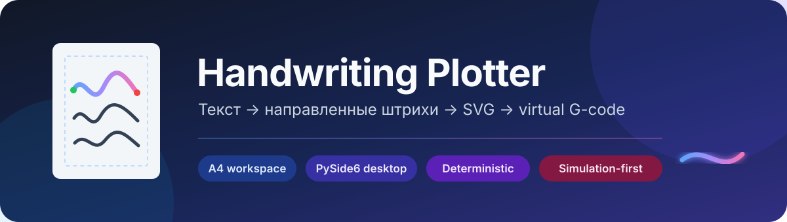

<div align="center">



[](https://github.com/6axam/CADPisun/actions/workflows/ci.yml)


**Инженерный desktop-инструмент для детерминированной компоновки одноштрихового письма на A4 и проверки виртуальной траектории плоттера.**

[Установить из ZIP](INSTALL.md) · [Руководство GUI](docs/gui-usage.md) · [Архитектура](ARCHITECTURE.md) · [Текущий прогресс](docs/implementation-status.md)

</div>

> [!IMPORTANT]
> Текущая сборка — **`0.2.0+20261023.1`**. Генерируемый G-code предназначен
> для профиля `virtual-cartesian-z-v1` и симуляции. Реальный станок пока не
> подключается. Продуктовый украинский стиль `ua-school-v1` ожидает авторские
> образцы и ручную приёмку; включённые стили явно помечены как test-only.

## Что уже работает

- **Редактор страницы A4:** текстовые блоки, поля, сетки, координаты и размеры в миллиметрах.
- **Направленное письмо:** Unicode → графемы → варианты → соединения → упорядоченный PenPlan.
- **Четыре рабочие области:** Object, Preview, Execution и Handwriting Studio.
- **Проверяемый экспорт:** production SVG, diagnostic SVG, PNG, отчёт и virtual G-code.
- **Референсы:** embedded-импорт SVG, PNG, JPEG, WebP, BMP и GIF без скрытой трассировки.
- **Воспроизводимость:** pinned StylePack revision, seed, canonical JSON и SHA-256.
- **Удобный desktop GUI:** undo/redo, multi-selection, dock-панели, горячие клавиши, EN/UK интерфейс.
- **Без облака и GPU:** основной pipeline работает локально и офлайн после установки зависимостей.

<table>
  <tr>
    <td width="50%"></td>
    <td width="50%"></td>
  </tr>
  <tr>
    <td align="center"><b>Object mode</b><br>Композиция страницы и свойства объектов</td>
    <td align="center"><b>Diagnostic preview</b><br>Порядок штрихов, travel и validation</td>
  </tr>
</table>

## Быстрый запуск

Git не требуется. Скачайте **Code → Download ZIP**, распакуйте архив и откройте
терминал в папке проекта. Полная инструкция с объяснением каждого шага и
решениями частых ошибок есть в [INSTALL.md](INSTALL.md).

### Windows 10/11 — PowerShell

```powershell
powershell -ExecutionPolicy ByPass -c "irm https://astral.sh/uv/install.ps1 | iex"
uv sync --python 3.12.12 --extra gui
uv run hplot-gui
```

### Arch / Omarchy / Ubuntu — Bash

```bash
curl -LsSf https://astral.sh/uv/install.sh | sh
uv sync --python 3.12.12 --extra gui
uv run hplot-gui
```

> [!NOTE]
> Windows CI выполняет headless Qt-тесты. Полный ручной GUI-проход на физической
> Windows-машине пока не заявлен.

## Рабочие области

| Режим | Назначение |
|---|---|
| **Object** | Создание текста, сеток и референсов; выделение, перемещение и изменение размеров |
| **Preview** | Diagnostic SVG, поднятые перемещения, start/end markers и полный virtual G-code |
| **Execution** | Безопасное проигрывание принятого PenPlan с виртуальной головкой и скоростью 0.5×–4× |
| **Handwriting Studio** | Запись направленных штрихов, обработка, нормализация, joins и test-only StylePack publication |

Панели Project, Editing, View, Properties и Output можно переставлять,
закреплять и скрывать. **Help → Controls** показывает текущие сочетания клавиш,
а **Tools → Program Settings** позволяет их переназначить.

## Результаты генерации

| Артефакт | Для чего нужен |
|---|---|
| `page-0001.svg` | Чистая production-геометрия страницы |
| `page-0001.preview.svg` | Диагностика порядка, travel и подписей операций |
| `page-0001.png` | Растровое представление production SVG |
| `page-0001.plan.json` | Авторитетный логический план пера |
| `page-0001.motion.json` | Аппроксимированный виртуальный план движения |
| `page-0001.gcode` | Проверяемый G-code для simulation-only профиля |
| `report.json` | Coverage, bounds, motion metrics, warnings и machine status |

SVG и G-code строятся из одного PenPlan. G-code не восстанавливается обратным
разбором SVG, а проходит независимый round-trip parser check.

## Архитектура

```text
Unicode text
    ↓
normalization → grapheme coverage → StylePack variants
    ↓
shaping and joins → A4 layout in millimetres
    ↓
PenPlan ───────────────┬───────────────┐
    ↓                  ↓               ↓
production SVG   diagnostic SVG   virtual MotionPlan
                                      ↓
                               validated G-code
```

Ядро не зависит от Qt. Desktop GUI вызывает тот же application API, что и CLI.
Проекты сохраняются как переносимый `hp-desktop-project/1.5`; абсолютные пути и
локальное расположение окон в файл не попадают.

## Проверка разработки

```bash
uv sync --python 3.12.12 --extra dev --extra import-svg --extra gui-dev
QT_QPA_PLATFORM=offscreen uv run pytest -q
uv build
```

Актуальная сборка прошла **223 теста** локально и GitHub Actions на Linux и
Windows. История критериев и выполненных этапов находится в
[docs/implementation-status.md](docs/implementation-status.md).

## Честные ограничения

- Нет hardware sender и профиля реального станка: кинематика, контроллер и механизм пера ещё не определены.
- Imported artwork служит только визуальным референсом и не превращается автоматически в штрихи.
- `test-technical-v1` проверяет pipeline, а `ua-school-v1-pilot` — ограниченную связную геометрию; оба не заменяют принятый продуктовый почерк.
- OCR, восстановление траектории по фотографии и ML относятся к последующим этапам и не имитируются заглушками.
- Один desktop document сейчас компонуется в один лист; переполнение объекта блокирует его машинный экспорт с диагностикой.

## Документация

| Документ | Содержание |
|---|---|
| [INSTALL.md](INSTALL.md) | Установка из GitHub ZIP на Windows, Arch/Omarchy и Ubuntu |
| [docs/gui-usage.md](docs/gui-usage.md) | Полный сценарий GUI, клавиши и Handwriting Studio |
| [ARCHITECTURE.md](ARCHITECTURE.md) | Слои, потоки данных и границы системы |
| [DATA_MODELS.md](DATA_MODELS.md) | Форматы, единицы и инварианты данных |
| [MODULE_CONTRACTS.md](MODULE_CONTRACTS.md) | Контракты модулей и ошибки |
| [DECISIONS.md](DECISIONS.md) | Архитектурные решения ADR |
| [TEST_STRATEGY.md](TEST_STRATEGY.md) | Стратегия и уровни проверки |
| [RESEARCH.md](RESEARCH.md) | Исследование готовых решений и библиотек |
| [RISKS.md](RISKS.md) | Блокеры, риски и уровень доказательности |
| [Project Frankenstein](docs/frankenstein/MASTER_PLAN.md) | Персональный handwriting workflow и Level B |

## Статус продукта

Программная вертикаль этапа I работает end-to-end:

**Unicode → StylePack → shaping → A4 → PenPlan → SVG → MotionPlan → virtual G-code.**

Следующий продуктовый рубеж — создание и независимая визуальная приёмка
полного авторского `ua-school-v1`, затем определение характеристик реального
оборудования и отдельный hardware profile.
