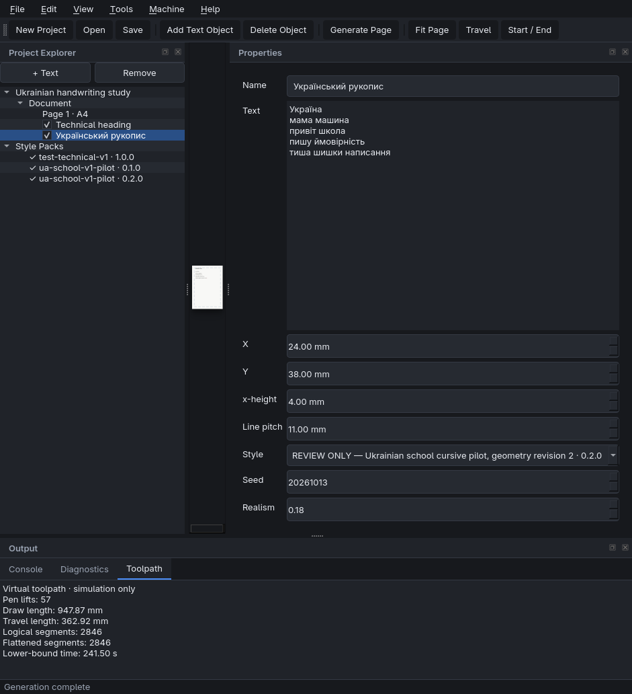
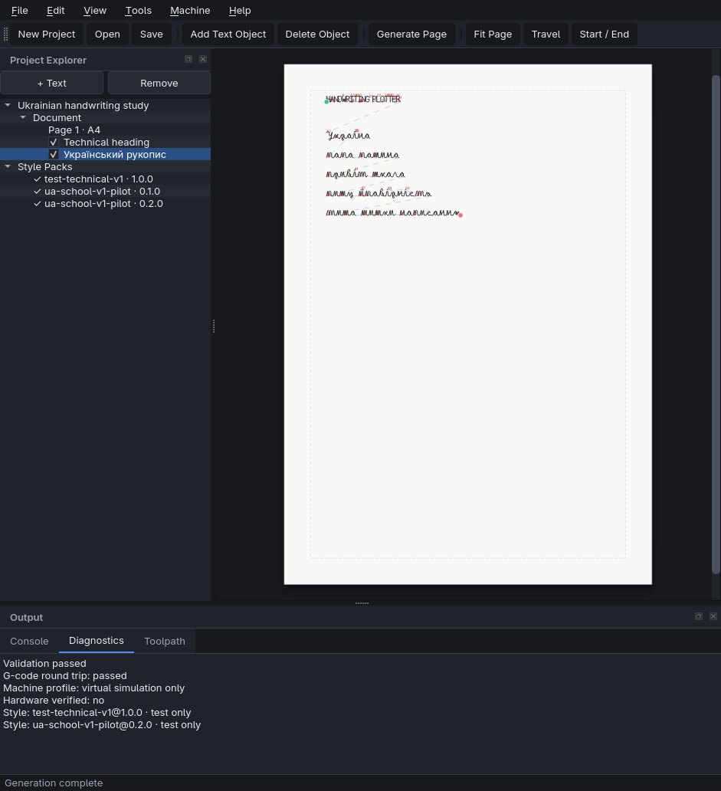

# Desktop GUI

## Установка и запуск

GUI является необязательной зависимостью. Обычный CLI не импортирует Qt.

```sh
uv sync --python 3.12.12 --extra gui
uv run hplot-gui
```

В Omarchy/Wayland Qt обычно выбирает Wayland platform plugin автоматически.
Если окружение запуска не передаёт тип сессии, его можно указать явно:

```sh
QT_QPA_PLATFORM=wayland uv run hplot-gui
```

Для разработки и всех тестов:

```sh
uv sync --python 3.12.12 --extra dev --extra import-svg --extra gui-dev
QT_QPA_PLATFORM=offscreen uv run pytest
```

Qt 6 сам применяет device pixel ratio для HiDPI. Размеры листа и геометрии в
приложении всё равно хранятся в миллиметрах, а не экранных пикселях.

## Рабочий процесс

Верхняя закрепляемая панель **Modes / Режими** содержит активный режим
**Object / Об’єкт**, **Preview / Перегляд** и **Execution / Виконання**.
Preview показывает diagnostic travel path и принятый virtual G-code. Execution
проигрывает операции плана и показывает положение виртуальной головки. Это
локальная симуляция; реальное оборудование не подключается и не управляется.

Панели **Project**, **Editing** и **View** содержат отдельные группы действий.
Все действия представлены квадратными символьными кнопками с полным названием
во всплывающей подсказке. Панель можно перетащить к другой границе окна,
отделить в плавающее окно или скрыть и вернуть через **View / Вигляд**.

1. Создайте проект через **File → New Project** или откройте существующий
   `*.hplot.json`.
2. Добавьте текст через **+ Text**. В дереве объект можно переименовать,
   скрыть флажком или удалить. Язык интерфейса выбирается через **Language**.
3. Выберите объект и задайте текст, начало относительно рабочей области,
   высоту символов, межсимвольный интервал, шаг и поворот строк, цветовую
   группу, StylePack, seed, realism и X/Y/ширину/высоту рабочей области в
   **Properties**. Диаметр управляет экранными маркерами объекта.
   Выберите Page 1, чтобы изменить поля A4 и ширину пера.
4. Для разметки добавьте **+ Grid** и настройте размер клеток, сплошную,
   пунктирную или штрих-пунктирную линию, цвет и привязку. Сетка не экспортируется
   и не участвует в G-code.
   **File → Import Artwork** добавляет SVG, PNG, JPEG, WebP, BMP или GIF как
   переносимый embedded-референс. Он также не превращается в траекторию пера.
5. Запустите **Tools → Generate Page**. Расчёт выполняется в фоне; старый
   результат никогда не заменит более новую ревизию проекта.
6. Включите **Travel** для diagnostic SVG и **Start / End** для маркеров
   первого и последнего движения. Эти слои не меняют экспортируемую геометрию.
7. Изучите реальные warnings и validation в **Diagnostics**, длины и число
   сегментов в **Toolpath**.
8. Сохраните проект и экспортируйте SVG, PNG, G-code или отчёт через
   **File → Export**.

Экспорт доступен только для результата текущей ревизии. **Production SVG** не
содержит travel/labels. **Diagnostic SVG** предназначен для анализа порядка.
**Virtual G-code** относится только к `virtual-cartesian-z-v1`, не проверен на
оборудовании и не отправляется устройству приложением.

## Клавиши и навигация

| Действие | Клавиша |
|---|---|
| Новый / открыть / сохранить | Ctrl+N / Ctrl+O / Ctrl+S |
| Undo / redo | Ctrl+Z / Ctrl+Shift+Z |
| Добавить / удалить объект | Insert / Delete |
| Сгенерировать страницу | Ctrl+Enter |
| Вписать лист | F |
| Масштаб | Ctrl+колесо |
| Панорамирование | Space+drag |

Текущие сочетания и все жесты доступны через **Help → Controls**. В
**Tools → Program Settings** язык и основные сочетания можно изменить; там же
есть сброс расположения dock-панелей.

На холсте клик выбирает объект. Рамка слева направо выбирает только полностью
охваченные объекты, справа налево — все пересечённые. Ctrl добавляет или убирает
объект из выбора. Перетаскивание выбранного поля двигает один объект или всю
выбранную группу. У одного выбранного объекта восемь маркеров размера: боковые
меняют одну ось, угловые сохраняют пропорции. При наведении граница становится
шире и пунктирной. Если текст не помещается в рабочую область, его штрихи не
попадают в экспорт, а в центре области появляется красный круг с белым крестом.
При включённой сетке ближайшая координата может привязаться
только по X, только по Y или по двум осям в точке пересечения.

Положение dock-панелей, размер окна и видимость диагностических слоёв
сохраняются локально в QSettings. Они не добавляют машинно-зависимые пути в
переносимый JSON проекта.

## Handwriting Studio

Переключатель **Document / Handwriting Studio** в верхней панели меняет рабочую
область, не закрывая и не изменяя текущий документ. В Studio:

1. выберите знак в коллекции слева или введите Unicode-метку справа;
2. задайте название личного стиля, variant ID, контекст и предварительный
   advance;
3. напишите знак на большом светлом поле несколькими штрихами;
4. при необходимости отмените/верните целый штрих, включите точки и направление,
   измените масштаб либо скорректируйте baseline и x-height guides;
5. убедитесь, что нижняя диагностика считает sample валидным, и нажмите
   **Save sample**;
6. дважды щёлкните знак в коллекции, чтобы открыть последний сохранённый
   вариант. Он также доступен после перезапуска программы.

Средняя кнопка мыши панорамирует поле; Ctrl+колесо меняет масштаб. Mouse input
не получает выдуманное давление. Для планшета pressure сохраняется только при
заявленной Qt capability. Исходные точки, порядок, pen-down/pen-up границы и
monotonic elapsed time сохраняются без сглаживания. Файлы `hp-capture/1.0`
лежат в platform application-data directory, а не в ZIP, checkout или
`site-packages`.

Сохранённый sample имеет статус `draft`. Наличие raw-записи ещё не делает её
проверенным glyph и не публикует StylePack: сначала нужны обработка,
нормализация, ручная аннотация и явное принятие варианта.

Над списком доступны украинская, русская, английская и собственная очереди.
Для собственной очереди перечислите буквы, пары, лигатуры, цифры, знаки или
слова через пробел и нажмите **Apply**. **Save & Next** сохраняет текущий raw
sample и переводит фокус на следующий токен. Previous/Next, Skip, Retry и Open
existing меняют persistent queue state. Required variants задаёт
экспериментальный порог полноты; строгие продуктовые ворота StylePack от этого
не ослабляются. Progress и counts строятся по сохранённым записям. **Reject
sample** исключает SHA-256 из редактируемой коллекции и coverage, не удаляя
raw-файл.

Справа варианты выбранного знака показаны рядом как миниатюры настоящих
штрихов. Двойной щелчок повторно открывает вариант. **Set preferred** оставляет
один основной вариант для этой Unicode-метки; **Remove from draft** создаёт
tombstone в истории черновика и скрывает миниатюру, сохраняя raw SHA-файл.
Контекст isolated/initial/medial/final задаётся вручную и не угадывается.

После сохранения нажмите **Process**, чтобы построить directed vector strokes.
**Tolerance** задаёт максимальную допустимую геометрическую погрешность в
logical pixels, а **Smoothing passes** — число необязательных проходов
сглаживания с защитой углов. Флажки **Raw** и **Processed** позволяют сравнить
серый исходный путь и синюю обработанную геометрию на одном поле. В диагностике
показывается SHA-256 derivative и его certified error bound.

Изменение параметров, метки, guides или исходных штрихов сразу убирает
устаревший processed overlay. **Undo processed** убирает только результат
обработки: raw points и их content-addressed файл остаются неизменными. Каждый
набор параметров сохраняется отдельным `hp-processed-capture/1.0`, связанным с
тем же raw SHA-256; последний доступный derivative восстанавливается при
повторном открытии sample.

Для нормализации один раз нажмите **Use guides for style**. Текущие ascender,
x-height, baseline и descender становятся общими метриками всего draft style;
они не вычисляются заново по высоте каждой буквы. Поэтому небольшая `о` остаётся
ниже высокой `л`, если именно так они были записаны относительно общих guides.

Задайте **Advance**, left/minimum right bearing и при необходимости явный
baseline offset, затем нажмите **Normalize**. Справа появится GlyphFrame preview
с baseline/x-height и подписанными physical x-height/advance в миллиметрах.
Поле physical preview задаёт желаемую x-height 2.5–5.0 mm и не обещает
экранный размер 1:1, поскольку DPI монитора приложению не калибруется.
Нормализованный `hp-normalized-glyph/1.0` сохраняет полный snapshot общих
метрик и ссылки на raw/processed SHA-256. Изменение controls убирает устаревший
preview и требует повторной нормализации, не меняя исходные файлы.

В **Manual joins and pen lifts** каждый исходный stroke остаётся на своём месте.
Выберите stroke, назначьте ему role body/mark/punctuation и укажите единственный
body для режима `single_body_deferred_marks`. Остальные mark strokes будут
отложены в исходном порядке. Entry/Exit всегда относятся к реальному началу и
концу body; вычисленные tangent vectors показаны рядом и не вводятся на глаз.

Anchor class, разрешённые partner classes и ограничения gap/vertical/angle
задаются вручную. **No join before/after** создаёт явный pen lift. После **Save
annotation** выберите другой анотированный variant и нажмите **Preview pair**.
Studio запускает тот же geometry-aware join engine, что и генератор, рисует
реальный connector при успехе и показывает точный reason для pen lift либо
reject. Невалидную пару Studio не «улучшает» выдуманным соединением.

Unicode-метка Studio может содержать 2–8 graphemes (`ма`, `ши`, `пр` и т. п.).
Такой sample записывается и обрабатывается целиком, без автоматического разрезания
траектории. Если границы символов известны, введите N−1 координат GlyphFrame gu
через запятую в **Character boundaries**; пустое поле честно сохраняет состояние
`unannotated`. Границы не меняют strokes и не являются новым распознавателем.

При последующей сборке sequence становится обычным multi-character glyph key.
Существующий longest-match resolver выбирает его, когда контекст подходит; без
него текст формируется из отдельных букв и обычной join logic. Публикация
лигатуры блокируется, пока для каждого её grapheme нет отдельного fallback.

После проверки нажмите **Accept reviewed variant**. Studio сохранит новую
ревизию annotation со статусом `reviewed` и пометит связанный immutable capture
как accepted в редактируемой чернетке. Это self-review локального автора для
ограниченной технической ревизии; действие не утверждает независимую или
продуктовую приёмку. Любое последующее изменение annotation снова возвращает
её в `draft` и требует повторного принятия.

В блоке **Test-only StylePack publication** укажите новую semantic revision и
ID автора/локального рецензента. Установите флажок подтверждения только после
просмотра всех accepted samples, затем нажмите **Validate draft**. Проверка
повторно загружает raw, processed, normalized и annotation по SHA-256, требует
общие style metrics, isolated variant для каждого key и одиночные fallback для
лигатур.

**Publish immutable revision** создаёт canonical `GlyphVariantFile`, review,
provenance и license records, вычисляет их SHA-256 и публикует новый каталог
`<application-data>/handwriting-studio/styles/<style_id>/<revision>`. Та же
ревизия не перезаписывается. Manifest пользовательского Level B пакета всегда
остаётся `approved=false`, `test_only=true`, `production_eligible=false`.
После успеха стиль сразу появляется в обычном picker Document Workspace рядом
со встроенными стилями; проект хранит явные `style_id` и `style_revision`.
Отсутствующая ревизия показывается как Missing и не подменяется другой.

Полный synthetic-only Level B audit находится в
[`examples/frankenstein-level-b/`](../examples/frankenstein-level-b/README.md).
Он содержит raw/processed/normalized/annotation цепочки, опубликованный
StylePack, четыре обязательных слова, оба SVG, PenPlan, MotionPlan, виртуальный
G-code, reopenable project и SHA-256 manifest. Этот bundle проверяет интеграцию,
но не качество человеческого почерка, планшет или физическое оборудование.

## Строка состояния и диагностика

Внизу слева показываются фактически измеряемая частота перерисовки холста и
координаты курсора X/Y в миллиметрах страницы A4. При выходе курсора за лист
координаты заменяются прочерками. Внизу справа всегда отображается версия
приложения, чтобы после обновления ZIP можно было проверить запущенную сборку.

Информационные сообщения сохраняют обычный цвет, успешные операции выделяются
зелёным, предупреждения — жёлтым, ошибки — красным. Во время фоновой обработки
показывается неопределённый progress bar. Он намеренно не выводит процент:
текущий backend не сообщает проверяемый общий объём работы. После завершения
индикатор показывает успешный или ошибочный результат и автоматически
скрывается.

## StylePack и ошибки покрытия

В Project Explorer перечислены все найденные ревизии StylePack и результат их
проверки. `test-technical-v1` и `ua-school-v1-pilot` явно помечены test-only.
GUI не заменяет отсутствующий символ похожим: `MISSING_GLYPH` показывает имя
объекта, символ и диапазон исходного текста, а принятый ранее холст сохраняется.

Пилот `ua-school-v1-pilot@0.2.0` позволяет оценивать текущую направленную
геометрию ограниченного украинского corpus. Он не является готовым
`ua-school-v1`. Для продуктового стиля нужны авторские направленные образцы,
provenance, полное покрытие и ручная визуальная приёмка из
[`docs/blockers.md`](blockers.md).

## Границы этапа

- Один лист композиции; текстовый объект, которому нужна вторая страница,
  отклоняется явно.
- Нет OCR, ML, трассировки импортированных фотографий и редактора Bézier-узлов; Studio публикует
  только явно проверенные capture derivatives как test-only StylePack.
- Нет реального machine profile, транспорта или кнопки отправки.
- Lower-bound time в Toolpath — результат виртуальной кинематической модели,
  а не измеренное время станка.

## Проверенный вид




